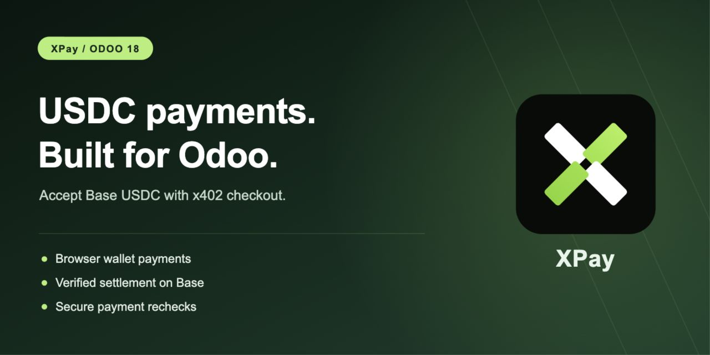

XPay for Odoo 18
================

Published by **X PAY LAB LIMITED**, British Virgin Islands company 2221444.

An independent Odoo 18 payment provider for order-bound x402 v2 payments using
Base mainnet USDC. Built for Odoo.sh and self-hosted installations.

* Injected browser-wallet checkout and existing-transaction payment-agent API.
* Exact payment terms and nonce binding, checked by XPay Facilitator.
* Independent Base receipt, USDC Transfer and AuthorizationUsed event checks.
* Durable authorization before settlement; serialized retries and receipt uniqueness.
* Pending-payment reconciliation, including recovery after an RPC outage.

Install
-------

Place payment_xpay_lab in an Odoo 18 add-ons path and install it from Apps.
Configure XPay USDC under Payment Providers as a system administrator. Use a
merchant Base receiving wallet and a settlement-enabled XPay merchant credential.
The server environment variable XPAY_FACILITATOR_KEY can supply the credential.

HTTPS is mandatory. USD and USDC totals only, quoted 1:1 in USDC. The extension is
free to download. XPay's stated merchant processing fee is 1%, subject to the
applicable merchant agreement. Obtain that agreement and confirm fees and
settlement permissions with support@x-pay.llc before enabling the provider.

See `the installation and agent guide <payment_xpay_lab/doc/index.rst>`_.

Compatibility and scope
-----------------------

**Odoo 18 only for this release.** Installation was checked with official Odoo
18 and PostgreSQL 15 Docker images. Odoo Online is unsupported. Versions 17,
19 and 20 are not claimed as supported until separately adapted and tested.

Base USDC only. No BNB, Solana, KRW, cards, custody, automatic refunds, recurring
payments, WalletConnect or currency conversion. Test mode does not send real
mainnet payments. Generic x402 clients need the documented order-bound nonce
extension. An included successful Base receipt is required; finalized-chain
settlement is not claimed.

Validation
----------

The disposable Odoo database passed **31 assertions** covering installation,
quotes, access checks, tampering, concurrency, durable timeout recovery, exact
receipt matching, duplicate receipt rejection and RPC-outage recovery.

Facilitator and RPC responses were mocked for settlement tests. **No real wallet
was charged, and live merchant credentials have not been tested.** Complete a
real-wallet staging payment and ordinary order/invoice acceptance before live
merchant use. See `validation results <tests/validation-results.json>`_.

The integration script in tests/integration_test.py is intended for odoo shell
against a disposable, freshly installed review database only. It commits test
fixtures intentionally; never run it against a production database.

Privacy and support
-------------------

The module sends authorized public payment details and signatures to XPay
Facilitator, and public receipt queries to Base RPC. The merchant credential
never goes to the customer or Base RPC. Customer contact and billing/shipping
details are not sent by the module. Protect signed authorizations, checkout
tokens, database backups and merchant credentials. See the module README for
complete external-service disclosures.

Website: https://x-pay.llc/

Support: support@x-pay.llc

License: GNU LGPL version 3. See LICENSE and payment_xpay_lab/COPYRIGHT.

Independent integration; no endorsement by Odoo, Circle, Coinbase or Base is
implied. Unrelated to Nexi XPay, xpayeg and similarly named payment services.
